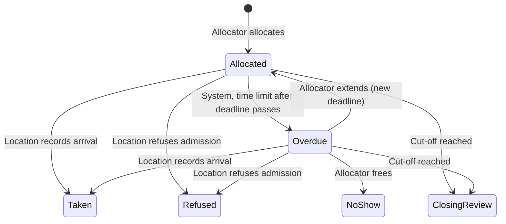

# Crash Bed Availability Board — Project Brief

Nov 2, 2026 · @Stephanie

## Purpose

A shared, live record of crash-bed availability across locations, so housing staff can make better-informed allocation decisions.

Judgement about people (needs, vulnerability, who can be reached) stays with the housing authority. The system makes sure that judgement never works from out-of-date bed information. As a by-product of what it records, it measures how often beds go unused and why.

**How it's used:** the board sits on the housing officer's screen, always visible while they take calls. It gives a rough picture of availability across locations, including places that are overdue or may free up, so officers can give callers a realistic idea of their chance of a bed tonight: a clear no when every place is taken, or advice to stay close to outreach when some places are overdue or still awaiting arrival. It also shows how well each location is keeping its records up to date. Decisions on overdue places stay with the officer's discretion: they know the people involved, and may free a place for someone who is late without good reason, or hold it for someone who needs longer to arrive.

This is a portfolio project inspired by volunteering in homeless services. It is not an official system of any organisation, and it uses synthetic data only.

## Problem and hypothesis

Crash beds released during the evening often go unused, because the people waiting for them can no longer be reached. Nothing currently records how often this happens.

Today the process runs on phone calls. A location tells the housing authority about a no-show only when it rings, and housing confirms availability by ringing round. Once someone leaves an outreach location, contact is often lost until morning.

**Hypothesis:** a meaningful share of places released during the evening are still empty at the 10:30pm cut-off, the later a place is released the less likely it is to be refilled, and most releases come from no-shows rather than admission refusals.

The system can test this from the bed side alone. It cannot yet show demand that never reached the allocation stage (see Metrics).

## Users and roles

Two roles use the system; the rest are part of the process but never log in. Roles are modelled, not organisations, so a new organisation needs no code change.

| Role | Who today | Uses the system? | Records |
| --- | --- | --- | --- |
| Allocator | Housing authority (24 hours) | Yes | Allocations, extensions, freeing overdue places, reallocations |
| Location | Queens Quarter, Fitzroy Avenue, Centenary House | Yes | Arrivals and admission refusals |
| Referrer | Service user directly, or a supporting service | No | Nothing; speaks to the allocator |
| Outreach | Welcome Centre, outreach vans | No | Nothing; works with the allocator to find people |
| Service user | The person needing a bed | No | Nothing |

## Glossary

| Term | Meaning |
| --- | --- |
| Night | One evening's allocation period, named by its date ("the night of 23 Oct"). Places can be used from 5pm, and the night ends at the admission cut-off, so it never crosses midnight. |
| Location | A crash-bed site with a nightly capacity. Individual beds are not modelled. |
| Capacity | How many places a location offers on a given night, split into female and male because rooms are single-sex. Can be reduced for a bed out of action. |
| Allocation | One place at one location, for one service user, for one night. Created only by the allocator. Carries the room type (female or male) and the agreed arrival deadline. |
| Place | A unit of capacity. A place is free when no active allocation uses it. |
| Overdue | Set by the system once a set time limit has passed after the arrival deadline with no arrival or refusal recorded. The place is still held, and shows as overdue on both housing's and the location's screens. |
| Extension | A new arrival deadline for an overdue allocation, agreed on the phone between housing and the location (for example, the person needs longer to travel). The allocation can go overdue again. |
| No-show | The allocator frees an overdue place because the person has not arrived. |
| Admission refused | The location turned the person away at the door. The place is free immediately. |
| Release | A place becoming free again. Happens in only two ways: the location records an admission refusal, or the allocator frees an overdue place as a no-show. |
| Arrival deadline | The time a person must arrive by, agreed individually when the place is allocated (often between 7:30 and 8:30pm). |
| Admission cut-off | The last time anyone found by outreach can be admitted (10:30pm). The same at every location. The night's snapshot is taken here. |

## The night timeline

1. **From 5pm:** places can be used. Housing allocates places as people call, each with an arrival deadline agreed with the person.
2. **Through the evening:** locations record arrivals and refusals. A refusal frees the place at once.
3. **A set time after each deadline:** an allocation with nothing recorded goes overdue. Housing and the location agree on the phone to extend it or free it.
4. **10:15pm:** each location's closing check lists its allocations not yet marked arrived or refused.
5. **10:30pm:** admission cut-off. The night closes, and housing reviews anything not taken.
6. **After the closing record is complete:** names are cleared.

Arrival deadlines are agreed per person, usually around 8pm. Places released after that have until the 10:30pm cut-off to be refilled (BR9).

## Allocation statuses and who owns them

Housing creates, extends and frees; the location records what happens at the door, and can free a place only by refusing admission. The system marks allocations overdue but never frees a place on its own. A place is free whenever no allocation on it is allocated, overdue or taken (BR8). At cut-off, anything still allocated or overdue goes into the closing review (BR10).

## Business rules

Each rule is numbered so tests and ADRs can cite it ("covers BR5").

1. **BR1:** An allocation lasts one night.
2. **BR2:** Only the allocator creates, extends, frees or reallocates allocations. The allocator checks free places on the board, records the allocation, then phones the location to tell them. The location holds the place until the person arrives.
3. **BR3:** Each fact has one owner. The allocator owns allocations; the location owns what happened at the door.
4. **BR4:** Locations record what happens at the door: arrived or admission refused. When a set time limit has passed after the arrival deadline with nothing recorded, the system marks the allocation overdue. The system never frees a place on its own.
5. **BR5:** An overdue place stays held in the person's name until the allocator either extends the deadline or frees it as a no-show. An arrival recorded before the place is freed keeps the place. Extending and freeing take no reason: the decision is the officer's discretion and stays off the record.
6. **BR6:** Once a place is freed, the original allocation is forfeited. A later arrival is not admitted to it.
7. **BR7:** Admission refused frees the place immediately. Refusal is at the location's discretion, as part of keeping service users and staff safe, and is the only way a location can free a place.
8. **BR8:** Places available = capacity − allocations that are allocated, overdue or taken, counted separately for female and male rooms. The board shows, for each location and room type, free places and overdue places. Both come from the allocation statuses; nobody records anything extra.
9. **BR9:** The arrival deadline is set per allocation, as agreed with the person. The admission cut-off is 10:30pm at every location. The cut-off and the time limit before an allocation goes overdue can both be changed without changing the system.
10. **BR10:** At the admission cut-off the night closes. The allocator reviews every allocation still not taken and records why: no-show, arrived but not recorded, refused but not recorded, or unknown. Free places are recorded as unused. The review is saved as the night's closing record.
11. **BR11:** Personal data on an allocation is the minimum the location needs to recognise the person, and is cleared once the closing record is complete.
12. **BR12:** Every arrival is recorded at the location's reception desk. Use is mandatory, so the board reflects who is actually in.
13. **BR13:** From 10:15pm, each location's screen shows a closing check: its allocations not yet marked arrived or refused, for reception to settle as part of their closing routine.

**Assumptions (process, not system rules)**

- Overdue and unrecorded allocations are raised during the evening's housing–location calls, when both are looking at the same screen.
- Before a place is extended or freed, housing and the location speak on the phone.
- Housing watches the board while placing people, and acts on overdue places when it needs a bed for someone else.
- A refusal not recorded at the time is usually remembered and recorded on the next call, prompted by the overdue state.

## Metrics and their limits

The system measures need and waste among people who reached the allocation stage. Demand that never got that far is out of scope for v1.

| Metric | Definition | What it can show | Limit |
| --- | --- | --- | --- |
| No-show rate | Allocations freed as no-shows, per location and night | Where and when people lose their bed | A no-show may have found somewhere else to stay |
| Admission refusals | Refusals at the door, with reason: previously barred or on the night | Whether housing could have known in advance | Depends on locations picking a reason |
| Refill rate | Released places reallocated before cut-off, and time to refill | How well the evening chase works | Says nothing about why a refill failed |
| Time overdue | How long places stay overdue before being extended, freed or taken | How long beds are held past their deadline, neither used nor free | Includes refusals that were recorded late |
| Wasted places | Released places still empty at cut-off | Beds that were available and unused | Ambiguous without demand: could mean nobody needed it |
| Releases by time of evening | When releases happen against whether they are refilled | Whether late releases are effectively unfillable | Needs enough nights to show a pattern. A refusal recorded late shows as a late release |

**Not reported as failure in v1:** an empty place at cut-off on its own. Until a demand figure exists, it cannot distinguish low demand from failed placement.

## Scope and non-goals

v1 is a bed ledger with a live board, not a case-management system.

**In scope**

- Locations and nightly capacity
- Allocations and their statuses, with owners
- A live board for the allocator, showing releases as they happen (tagged no-show or refused), each allocation's arrival deadline, and when each location last updated
- A closing check for reception from 10:15pm, listing that location's allocations not yet marked arrived or refused
- Overdue places shown on both screens, with one action for the allocator: extend the deadline or free as a no-show
- Night close at the admission cut-off, saved as a closing record, with a list of allocations left incomplete, and the metrics above
- Nightly and trend reports of the metrics above

**Non-goals**

- Referrals, the waiting queue and decisions about people; these stay in housing's own system
- Contact details, sleeping locations or any tracking of where people are
- Duplicate matching or identity checks
- Use by service users, referrers or outreach
- Integration with housing's own system (see Extension path)

## Data protection

The system holds almost no personal data by design, because decisions about people stay with housing.

- **Stored:** a name and room type (female or male) on each allocation, enough for the location to place and recognise the person.
- **Not stored:** date of birth, NI number, contact numbers, sleeping locations, reasons for homelessness, eligibility reasons, reasons for extending or freeing a place.
- **Retention:** names are cleared once the closing record is complete, and by a fixed time regardless if closing is never completed. Metrics contain no names.
- **Access:** allocators see all locations; location staff see only their own location's allocations for tonight.
- **Repository:** synthetic data only. No real names or records, ever.

If this were used for real, it would also need a data protection impact assessment and agreements between the organisations involved.

## Extension path

The main gap is demand: how many eligible people were still waiting at cut-off. Three ways to fill it, in rising order of effort:

| Option | Effort | Gives | Cost |
| --- | --- | --- | --- |
| Manual count | Low | One number per night: people still waiting at cut-off | Relies on housing entering it |
| Record referrals here | Medium | Full demand data | Brings back personal data and duplicate matching |
| Integrate with housing's system | High | Demand without double entry | Data-sharing agreements; their system may have no API |

Whichever option is chosen, demand should arrive as counts, not as details of people.

## Open questions and decisions to record

**Open questions**

- [x] Confirmation: housing checks the board, records the allocation, then phones the location to tell them.
- [x] Beds are restricted by gender only; capacity is split female and male.
- [x] Arrival deadlines are agreed per person.
- [x] The admission cut-off is 10:30pm at every location.
- [x] Every location has a staffed reception desk, so recording arrivals can be mandatory.
- [x] The board shows when each location last updated, and incomplete allocations at night close.
- [x] Missed check-ins are caught during the evening's calls, since housing and the location look at the same screen.
- [x] Untaken allocations at cut-off are caught by final calls, reception's closing check (BR13) and the end-of-night review. Accepted risk: a record may occasionally be missed, and the review measures how often.
- [x] Names are cleared even if the closing record is never completed.
- [ ] Backstop time: by when are names cleared if closing is never completed?

**Decisions to record as ADRs**

1. Model capacity as counts per room type (female or male), not individual beds.
2. One owner per fact: allocator owns allocations, location owns door outcomes.
3. Overdue is set automatically; no place is ever freed automatically.
4. Late-arrival race: a recorded arrival blocks reallocation.
5. Minimal personal data, cleared at night close.
6. Demand data out of scope for v1.
7. Extending and freeing take no reason.
8. Accepted risk: occasional missed records at night close, measured by the end-of-night review.
